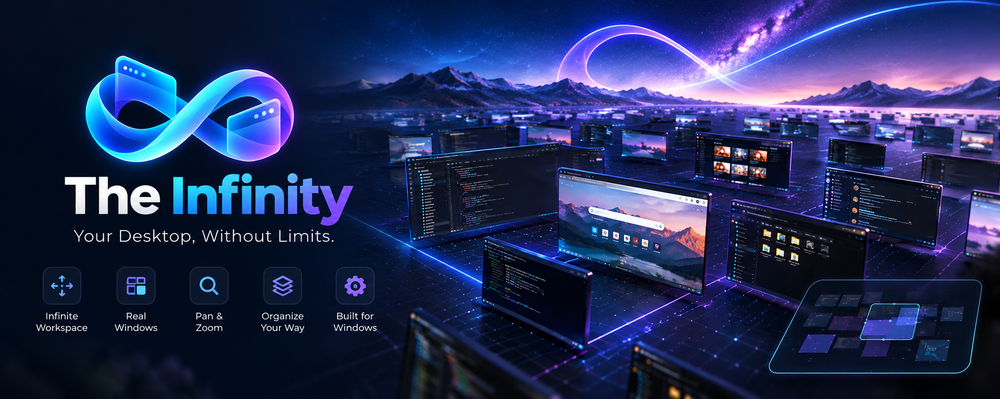
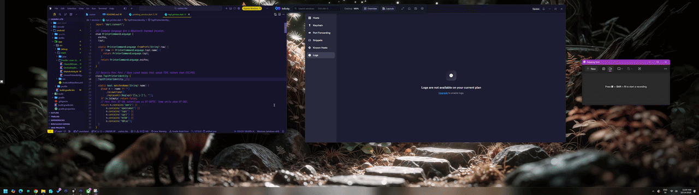
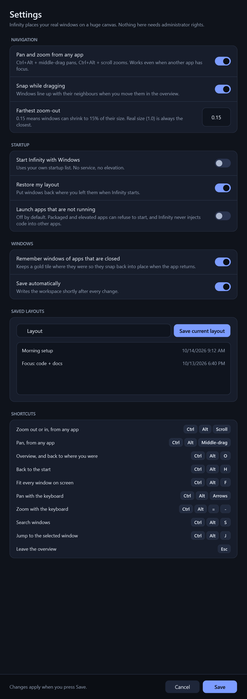

<p align="center">
  
</p>

# The Infinity

The Infinity turns your Windows desktop into one big canvas. Zoom out and every open window shrinks into a live thumbnail. Click a thumbnail and you zoom back in to the real window, ready to type. Drag thumbnails around to rearrange them, and the real windows follow when you zoom back.

I wanted something like [Deskspace](https://github.com/djekanovic/Deskspace) that I could read, change and build myself. It is a native Windows app: C#, WPF, and the Win32 and Desktop Window Manager APIs. No Electron, no web view, and nothing is injected into other programs.

<p align="center">
  
</p>

<p align="center">
  
</p>

Status: early. It works for me day to day, but expect rough edges with elevated windows, Store apps and mixed-DPI monitors (see [What does not work](#what-does-not-work)).

## How it behaves

- At 100% zoom you are on your normal desktop. Below that you are in the overview, which shows live thumbnails over your own wallpaper. Zoom level is the only mode, so there is nothing to switch.
- Windows cannot be scaled up, so 100% is the maximum zoom.
- Clicking a thumbnail zooms to that window and focuses it.
- `Ctrl+Alt` plus the mouse wheel zooms and `Ctrl+Alt` plus a middle-button drag pans, from any app.
- Thumbnails snap to their neighbours when you drag them. A pinned window stays fixed on the screen while you pan.
- The command bar has search, a Layouts menu (save the current arrangement under a name, click one later to go back to it), and shortcuts to settings.
- If you close an app, its tile stays as a gold "Not running" outline and the window snaps back into place when the app returns.

## Install

### Download

There are no releases yet. CI builds a self-contained zip on every push; look for the `TheInfinity-win-x64` artifact on the repository's Actions page.

### Build from source

You need Windows 10 (1809) or Windows 11 on x64, and the [.NET 10 SDK](https://dotnet.microsoft.com/download/dotnet/10.0). Check with `dotnet --version`.

```powershell
git clone https://github.com/<your-account>/the-infinity.git
cd the-infinity

dotnet build TheInfinity.slnx
dotnet test TheInfinity.slnx
dotnet run --project src/TheInfinity.App -c Release
```

The Win32 tests open a few small windows for a second. Set `INFINITY_SKIP_DESKTOP_TESTS=1` to skip them, for example on a machine with no desktop session.

### Install it like a normal app

```powershell
.\installer\publish.ps1
```

That writes two things into `dist`:

- `TheInfinity-1.0.0.msi` installs for the current user only. Double-click it. It does not ask for administrator rights. The app goes to `%LocalAppData%\TheInfinity\app` and a Start menu shortcut is added. Windows will say the publisher is unknown because the package is not signed; choose "More info", then "Run anyway".
- `TheInfinity-1.0.0-win-x64.zip` is the same build as a folder, if you would rather not use an installer.

`Install.ps1` copies a build into the same folder without an MSI. `Install.ps1 -FromBuild` uses a plain Release build instead of the published one. "Start with Windows" is a setting in the app. It writes to the current user's Run key, so no service and no elevation.

Uninstall from Windows Settings, Apps. That removes the shortcut. Your workspace database in `%LocalAppData%\TheInfinity` is left in place.

## Controls

| What | How |
| --- | --- |
| Zoom out or in, from anywhere | `Ctrl+Alt` + scroll wheel, or `Ctrl+Alt+-` and `Ctrl+Alt+=` |
| Pan, from anywhere | `Ctrl+Alt` + middle-drag, or `Ctrl+Alt` + arrow keys |
| Zoom into a window | Click its thumbnail |
| Overview on or off | `Ctrl+Alt+O`, or `Esc` in the overview. It returns you to exactly where you were. |
| Home, fit everything | `Ctrl+Alt+H`, `Ctrl+Alt+F` |
| Refresh, search, jump to selected | `Ctrl+Alt+R`, `Ctrl+Alt+S`, `Ctrl+Alt+J` |
| While zoomed out | Scroll zooms, middle-drag or dragging empty space pans, `Shift`+scroll pans sideways, `Alt`+scroll pans up and down |
| Move a window | Drag its thumbnail |
| Select several | `Ctrl`+click, or `Shift`+drag on empty space |
| More actions | Right-click a thumbnail: focus, minimize, maximize, close, pin, forget |

<p align="center">
  
</p>

Your data is in `%LocalAppData%\TheInfinity`: `workspace.db` (SQLite: windows, layouts, settings) and `logs\infinity.log`. Settings are behind the gear button or the tray icon. The `--render-ui <folder>` flag writes PNGs of the command bar and settings window without touching your desktop; it is how the screenshots above were made.

## How it works

Every window has a position on the canvas. The viewport has a scale and an offset, and a window is drawn at `(canvas - offset) * scale` on screen. Panning moves the viewport, not the windows.

At scale 1 the real windows are placed with `SetWindowPos`. A window that would land well outside the screen is minimized instead of being parked at some huge coordinate. Below scale 1 the app shows `DwmRegisterThumbnail` previews on its own window and leaves the real windows alone until you zoom back in. Minimized windows can usually still be previewed live; if Windows will not draw one, the app shows a snapshot it took just before minimizing, or an icon.

Window handles are never saved. The database stores the executable path, window class and title, and on startup running windows are matched back to saved positions. Apps that are not running stay as placeholders, and launching them is off unless you turn it on.

```text
src/
  TheInfinity.Core/          viewport math, snapping, workspace session, window matching (no Windows APIs)
  TheInfinity.Win32/         EnumWindows, SetWinEventHook, SetWindowPos, DWM thumbnails, mouse hook
  TheInfinity.Persistence/   SQLite store with PRAGMA user_version migrations
  TheInfinity.App/           WPF shell, view models, tray, hotkeys
tests/
  TheInfinity.Core.Tests/    pure logic and the SQLite store
  TheInfinity.Win32.Tests/   real windows: move, minimize, snapshots, DWM thumbnails
installer/                   publish.ps1, the per-user MSI, and Install.ps1
docs/                        screenshots and the manual test checklist
```

## What does not work

The app injects nothing and needs no admin rights, which limits what it can do:

- Elevated windows reject moves, focus and close requests from a normal process.
- The path of a protected or elevated process cannot always be read, so matching falls back to the process name and title.
- Store apps are hosted by `ApplicationFrameHost`. They are tracked, but they often cannot be launched again, and suspended ones may only show an icon.
- Exclusive-fullscreen games ignore position changes.
- Windows restricts `SetForegroundWindow`. The app briefly attaches input queues to get around that, and Windows can still refuse.
- One overview window does not cover mixed-DPI monitors perfectly.
- The global middle-drag uses a low-level mouse hook. That observes input and does not inject it, but if you need plain middle-click in other apps you can turn it off in settings.

On shutdown the app removes its hooks, hotkeys and thumbnails and writes a "clean exit" flag. After a crash the next start restores the last saved state.

## Inspiration and references

- [Deskspace](https://github.com/djekanovic/Deskspace) by djekanovic, an open-source infinite-canvas window manager for Windows. This project started from the same idea.
- [Novastart's infinite canvas](https://novastart.com/infinite-canvas/): zoom out to plan, zoom in to work.
- [Zooming user interface](https://en.wikipedia.org/wiki/Zooming_user_interface), the older idea behind both.
- [PowerToys FancyZones](https://learn.microsoft.com/windows/powertoys/fancyzones), a different way of arranging windows.

Windows documentation I leaned on: [DWM thumbnails](https://learn.microsoft.com/windows/win32/dwm/thumbnail-ovw), [`SetWinEventHook`](https://learn.microsoft.com/windows/win32/api/winuser/nf-winuser-setwineventhook), [`SetWindowPos`](https://learn.microsoft.com/windows/win32/api/winuser/nf-winuser-setwindowpos) and the [hooks overview](https://learn.microsoft.com/windows/win32/winmsg/about-hooks).

## Contributing

Issues and pull requests are welcome; open an issue first for anything big. [CONTRIBUTING.md](CONTRIBUTING.md) covers the layout and a few ground rules (documented APIs only, no saved window handles, nothing launched without consent). [docs/manual-testing.md](docs/manual-testing.md) lists what the automated tests cannot check.

## How this was made

A large part of this code was written with an AI coding assistant (Cursor), with me directing the design, running it on my own machines and fixing what did not work. I review what goes in, but you should read it with that in mind, and bug reports are appreciated.

## License

The Infinity is open source under the [MIT license](LICENSE). You can use it, change it, and share it, including in your own projects, as long as you keep the copyright notice. Copyright Lokeswara Sane.
